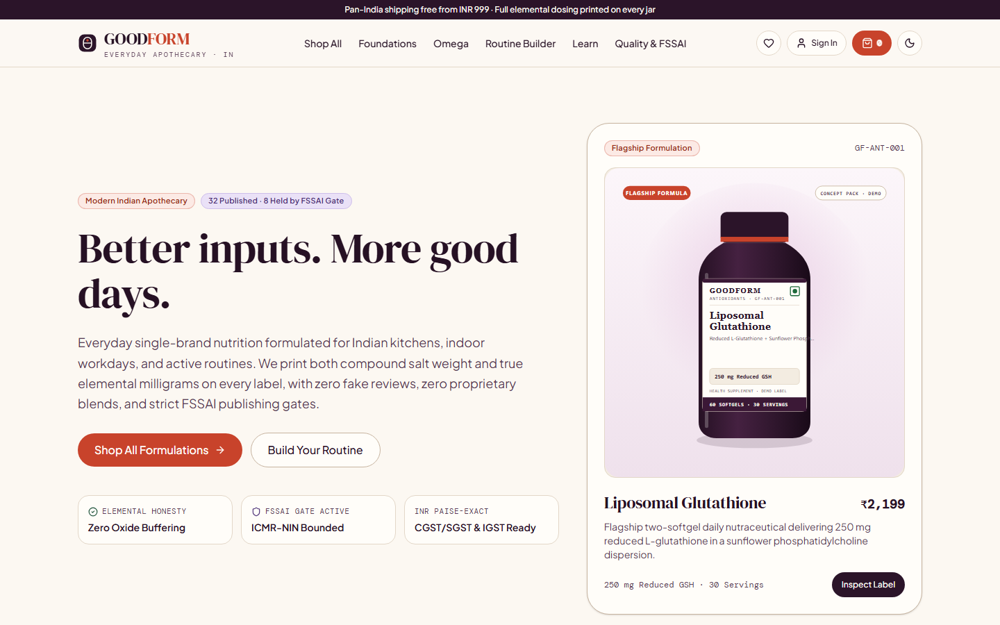
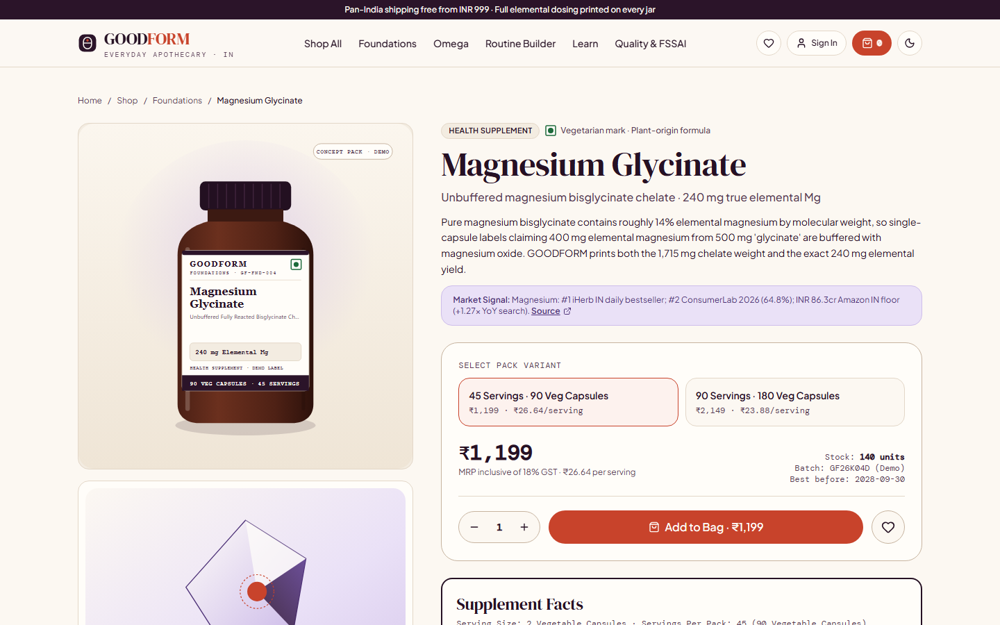
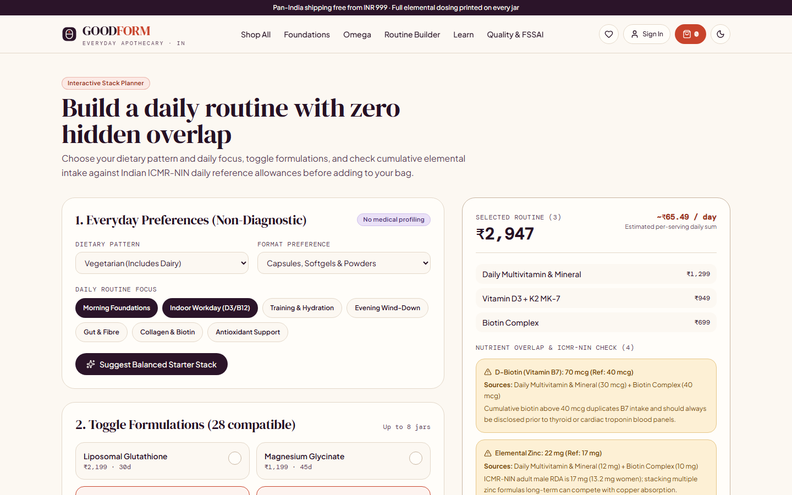
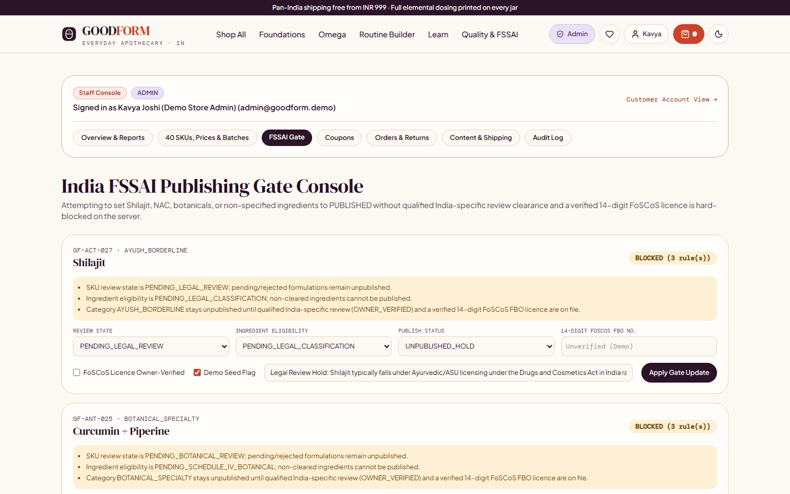

# GOODFORM

**Better inputs. More good days.** Single-brand holistic supplements store for India with 40 seeded formulations, an India FSSAI publishing gate, integer-paise INR pricing with intra/inter-state GST, a non-diagnostic Routine Builder with nutrient overlap cautions, and an RBAC staff console.

[](https://goodform-health.vercel.app)
[](https://github.com/devtechedge/goodform-health/actions/workflows/ci.yml)
[](https://nextjs.org/)
[](https://www.typescriptlang.org/)
[](https://neon.com/)
[](./LICENSE)

## Live Demo

**Production URL:** <https://goodform-health.vercel.app>

> **Live Environment & Honesty Note:** Production runs against persistent managed **Neon PostgreSQL** (`ap-southeast-1`) with all 40 seeded formulations, carts, wishlists, routines, orders, returns, and audit trails stored in Postgres. Because live Razorpay/Stripe merchant keys are intentionally omitted on the public preview, checkout runs in **Non-Charging Demo Mode**: orders record `orderStatus = DEMO_ORDER` and `paymentStatus = DEMO_NON_CHARGING` (never marked Paid) and collect zero card or UPI numbers. All 40 packshots are marked **Concept Pack - Demo Only**, and FoSCoS FBO licence / COA fields remain marked unverified until confirmed by a store owner.

## Screenshots

| Storefront Dispensary (`/`) | Supplement Facts & Stoichiometry (`/product/magnesium-glycinate`) |
| --- | --- |
|  |  |
| **Routine Builder & Overlap Cautions (`/routine-builder`)** | **India FSSAI Publishing Gate Console (`/admin/compliance`)** |
|  |  |

## Key Capabilities

- **40 Seeded Formulations + India FSSAI Publishing Gate:** All 40 requested SKUs live in PostgreSQL. A server-side gate publishes 32 compliant Health Supplement, Nutraceutical, Probiotic, Prebiotic, and FSDU items while automatically withholding 8 SKUs (**Shilajit**, **NAC**, **Ashwagandha Root Extract**, **Milk Thistle Extract**, **Curcumin + Piperine**, **Magnesium L-Threonate**, **L-Theanine**, and **Greens & Superfoods Blend**) from public listing and purchase pending India-specific legal, CDSCO/AYUSH, Schedule IV botanical, or Non-Specified Food clearance.
- **Elemental Stoichiometry & Honest Signals:** Mineral labels print both compound salt weight and true elemental milligrams (for example 1,715 mg unbuffered magnesium bisglycinate = 240 mg elemental Mg). Zero fake reviews, star ratings, or urgency timers; category context badges cite primary research (`impuls8`, `ConsumerLab`, `Loop Health WHI`, `iHerb India`).
- **Non-Diagnostic Routine Builder:** Filters by dietary origin (`Vegan` / `Vegetarian` / `Omnivore`) and format, aggregates elemental nutrients across 18 overlap keys, flags ICMR-NIN daily reference overlaps (such as stacking Vitamin D3, Zinc, or Biotin), and supports 1-click bag add, account saving, and shareable URLs.
- **Full-Stack INR Commerce:** Guest-to-account transactional cart merge, wishlists, `PERCENT` and `FIXED_PAISE` coupons (`WELCOME10`, `ROUTINE250`), integer-paise arithmetic, 6-digit Indian PIN & state validation, Maharashtra `CGST + SGST` vs inter-state `IGST` breakdown, atomic conditional stock updates (`WHERE stock_on_hand - stock_reserved >= qty`), idempotent order creation, self-serve returns, and 1-click reorder.
- **Payment & Email Adapters:** Official `razorpay` and `stripe` SDK adapters with constant-time HMAC signature verification and replay-idempotent `payment_webhook_events`, honest `DEMO_NON_CHARGING` fallback when keys are absent, plus an `email_outbox` sink and consent-gated newsletter with 1-click token unsubscribe.
- **Protected `/admin` Console:** Server-enforced RBAC (`CUSTOMER`, `MERCHANDISER`, `COMPLIANCE_OFFICER`, `ADMIN`) with immutable `audit_logs` across all 40 SKUs, variant batches/expiries, FSSAI compliance states, coupons, orders, returns, and shipping settings. Demo accounts (`@goodform.demo`) are strictly disabled when `APP_ENV=production`.

## Tech Stack

| Layer | Technology |
| --- | --- |
| Framework | Next.js 16.4 (App Router), React 19.3, TypeScript 5.9 (`strict: true`) |
| Styling & Typography | Tailwind CSS 4, CSS Custom Properties (Warm Ivory / Aubergine / Persimmon / Lilac + Dark Theme), self-hosted `DM Serif Display`, `Plus Jakarta Sans`, `DM Mono` |
| Database & ORM | PostgreSQL (Neon in production, Postgres 17 in CI, embedded PGLite fallback locally), Drizzle ORM 0.45 |
| Validation & Security | Zod 4, `crypto.scryptSync` + `timingSafeEqual`, `httpOnly` SHA-256 session tokens, HMAC guest cookies, CSP/HSTS headers, hashed-IP rate limiting |
| Payments | Official `razorpay` & `stripe` Node SDKs + non-charging demo adapter |
| Testing & QA | Vitest 5 (unit + Postgres integration), Playwright 1.65 + `@axe-core/playwright` (WCAG 2.2 AA) |

## Quick Start

```bash
git clone https://github.com/devtechedge/goodform-health.git
cd goodform-health
npm install
cp .env.example .env

# Zero-config local start (auto-boots embedded PGLite and seeds all 40 SKUs):
npm run dev
```

Open `http://localhost:3000`. To run against an external PostgreSQL / Neon instance instead, set `DATABASE_URL` and `DATABASE_URL_UNPOOLED` in `.env`, then run:

```bash
npm run db:migrate
ALLOW_PROD_SEED=1 npm run db:seed:demo
npm run dev
```

## Verification Commands

```bash
npm run lint               # ESLint 9 + Next core-web-vitals + strict TS rules
npm run typecheck          # next typegen && tsc --noEmit
npm test                   # Vitest unit suites (FSSAI gate, paise/GST math, routine overlaps, crypto)
npm run test:integration   # Full-stack SQL integration suites (oversell rollback, cart merge, RBAC, webhooks)
npm run build              # Production Next.js build
npm run e2e                # Playwright journeys, 390/768/1440px overflow checks & axe WCAG 2.2 AA
npm run smoke              # Live production health, headers, sitemap & route probe
```

## Documentation

- Product & IA: [`docs/PRODUCT.md`](./docs/PRODUCT.md)
- System Architecture: [`docs/ARCHITECTURE.md`](./docs/ARCHITECTURE.md)
- Market Signals & Methodology: [`docs/RESEARCH.md`](./docs/RESEARCH.md)
- India FSSAI & Claims Compliance: [`docs/COMPLIANCE.md`](./docs/COMPLIANCE.md)
- Deployment Runbook: [`docs/DEPLOYMENT.md`](./docs/DEPLOYMENT.md)
- Testing Guide: [`docs/TESTING.md`](./docs/TESTING.md)
- Threat Model & Security Policy: [`SECURITY.md`](./SECURITY.md)

## Demo & Compliance Limits

- **Not for medicinal use:** Supplements are not intended to diagnose, treat, cure, or prevent any disease. FSSAI rules are referenced for governance only and never imply FSSAI endorsement.
- **Commercial launch blockers (intentional):** Before setting `APP_ENV=production`, a licensed Indian food business operator must supply verified 14-digit FoSCoS FBO licence numbers, NABL batch COAs, final physical packaging labels, and live Razorpay/Stripe + Resend credentials.

## License

MIT - see [`LICENSE`](./LICENSE).
